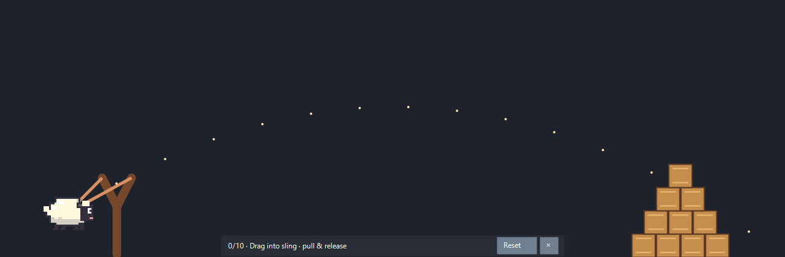

<p align="center"></p>

# DinnerTray

**A tiny video in your Windows tray. A small flock on your desktop.**

DinnerTray turns a playing browser video into an animated notification-area icon. Click it to return to the video; right-click for playback controls, desktop sheep, or a slingshot game along the taskbar.

[](https://github.com/bkeating/DinnerTray/actions/workflows/build.yml)
[](LICENSE)

Built by **The American Spreadsheet Company**.

## Get started

**Requirements:** Windows 11 on an Intel/AMD x64 computer, and Google Chrome or Microsoft Edge. Internet access is needed for streaming video. Chrome is not bundled with DinnerTray.

1. Download the Windows x64 ZIP from a [published release](https://github.com/bkeating/DinnerTray/releases), if available, and extract `DinnerTray.exe`. You can also build it below or get the `DinnerTray-windows-x64` artifact from a successful [Actions run](https://github.com/bkeating/DinnerTray/actions/workflows/build.yml). GitHub may require signing in to download Actions artifacts.
2. Save the executable somewhere permanent and double-click it. The portable build includes .NET; there is no installer.
3. Play a video in the browser window DinnerTray opens. Its tray icon becomes the video.
4. If the icon is hidden, open the **^** overflow beside the clock and drag it onto the notification area.

**Updating:** choose **Quit DinnerTray** from its tray menu before replacing or opening a newer copy. Only one instance runs at a time. Builds are currently unsigned; Windows may display a publisher/reputation warning.

## An absurdly small cinema

- The complete video is fitted into a square tray icon, with letterboxing and a target update rate of about 12 fps.
- **Left-click** restores the video tab. **Right-click** offers play/pause and the rest of the app.
- Audio continues through the browser. Minimizing its window lets you watch in the tray.
- A focused playing tab takes priority; otherwise DinnerTray favors the current playing tab. Larger playing video elements take priority over small previews on the same page.
- On YouTube, persistent transient player errors can trigger a limited refresh and position restore. Ordinary pauses and buffering do not.

### Which videos work?

DinnerTray supports ordinary HTML video elements on HTTP/HTTPS pages in **its own browser window**. Existing personal browser windows are not connected. Players inside cross-origin frames or closed shadow roots are not currently supported.

**Protected video is not guaranteed to work.** Netflix testing showed encrypted playback advancing while frame capture returned black pixels. DinnerTray reports **“Protected video — frame unavailable”** in that case. Other sites may block canvas capture through browser origin restrictions. DinnerTray does not bypass DRM or change browser security settings. Basic play/pause and click-to-return may still work when pictures cannot be captured.

## Meet Woolly

Choose **Spawn a sheep** in the tray menu. Woolly walks along exposed window tops, blinks, and tumbles down to another window or the taskbar.

- **Drag and drop:** pick up a sheep and release it above a window edge.
- **Fling:** release while moving to throw it along a gravity-driven arc. Hold still briefly before releasing for a plain drop.
- Spawn up to 12 sheep. Right-click one to send it home, or dismiss the entire flock from the tray menu.
- Sheep do not take keyboard focus or add taskbar buttons. Transparent areas let clicks pass through.

Use restored windows to give sheep visible title-bar platforms. Moving, minimizing, or closing a supporting window makes them fall. Quitting DinnerTray sends the flock home; sheep are not restored on startup.

## A slingshot across the taskbar

Choose **Slingshot game / Reset blocks**. A sling appears at the left and a wooden pile at the right of the selected monitor, just above the taskbar.

1. Drag a sheep into the dotted sling circle and release to load it.
2. Grab the loaded sheep again and pull back. Direction and distance set the launch.
3. Follow the dotted trajectory and let go. Blocks slide, crack, and shatter.
4. Use **Reset** for another pile or **×** to close the game. The sheep stay.



*Rendered preview on a neutral background. In use, the background is transparent and your desktop remains visible.*

The game uses gravity, momentum, collision impulses, and small physics steps. Blocks have simplified axis-aligned collisions rather than full rotating rigid-body physics. Sling shots ignore window tops so the pile stays reachable. Monitor work-area changes close the game to avoid stranded overlays.

**Status:** experimental desktop software. Core video playback has been used interactively. Automated tests cover recovery, throwing, collisions, and reachable game targets at 1280, 1920, and 3440 pixels. Full live mouse-interaction and mixed-DPI desktop testing are still needed; passing tests are not a claim of universal desktop compatibility.

## Build and test

Install the **.NET 10 SDK** on Windows. **Node.js 22+** is needed for the JavaScript tests, not for running DinnerTray.

```powershell
git clone https://github.com/bkeating/DinnerTray.git
cd DinnerTray
./test.ps1
./build.ps1 -Portable
```

The standalone executable is `dist/DinnerTray.exe`. Send that single file to someone else. The roughly 116 MB size includes the .NET runtime. No personal browser data is packaged.

For a smaller build that requires the .NET 10 Desktop Runtime on the recipient's computer, omit `-Portable`. To create a release ZIP and SHA-256 checksum, run `./package.ps1`. Build and test scripts stop on failures.

See [development notes](docs/DEVELOPMENT.md) for the source layout, debugging switches, and release process.

## Browser profile and privacy

DinnerTray launches installed Chrome (or Edge as a fallback) with a separate saved profile and a loopback-only DevTools connection. That connection supplies video frames and playback controls. Your ordinary browser profile is not attached or copied.

- Browser logins, history, and cookies stay in `%LOCALAPPDATA%\DinnerTray\Browser`.
- The app has no telemetry or backend. Sites you visit retain their usual network and account behavior.
- A bounded local `recovery.log` records recovery times and numeric media-error codes without video titles or URLs.
- Opt-in `--diagnostics` saves playback counters and the latest tiny video frame locally. Those files are not included in release packages.
- The dedicated profile is browser-controllable by software on your machine; use it for playback rather than unrelated sensitive browsing. Quit leaves the browser open; closing its windows ends that browser session.

To uninstall, quit DinnerTray and remove its executable. To also remove its browser data, close its browser windows before deleting `%LOCALAPPDATA%\DinnerTray`. That clears the dedicated profile's saved logins too.

## Contributing

Bug reports, desktop compatibility testing, and new creature ideas are welcome. Read [CONTRIBUTING.md](CONTRIBUTING.md), check the [known limitations](docs/DEVELOPMENT.md#known-limitations), and open an [issue](https://github.com/bkeating/DinnerTray/issues). See [SECURITY.md](SECURITY.md) for sensitive reports.

DinnerTray and Woolly's original artwork are available under the [MIT license](LICENSE). This is an independent project, not affiliated with video services, browser vendors, or the creators of classic desktop pets or slingshot games.
